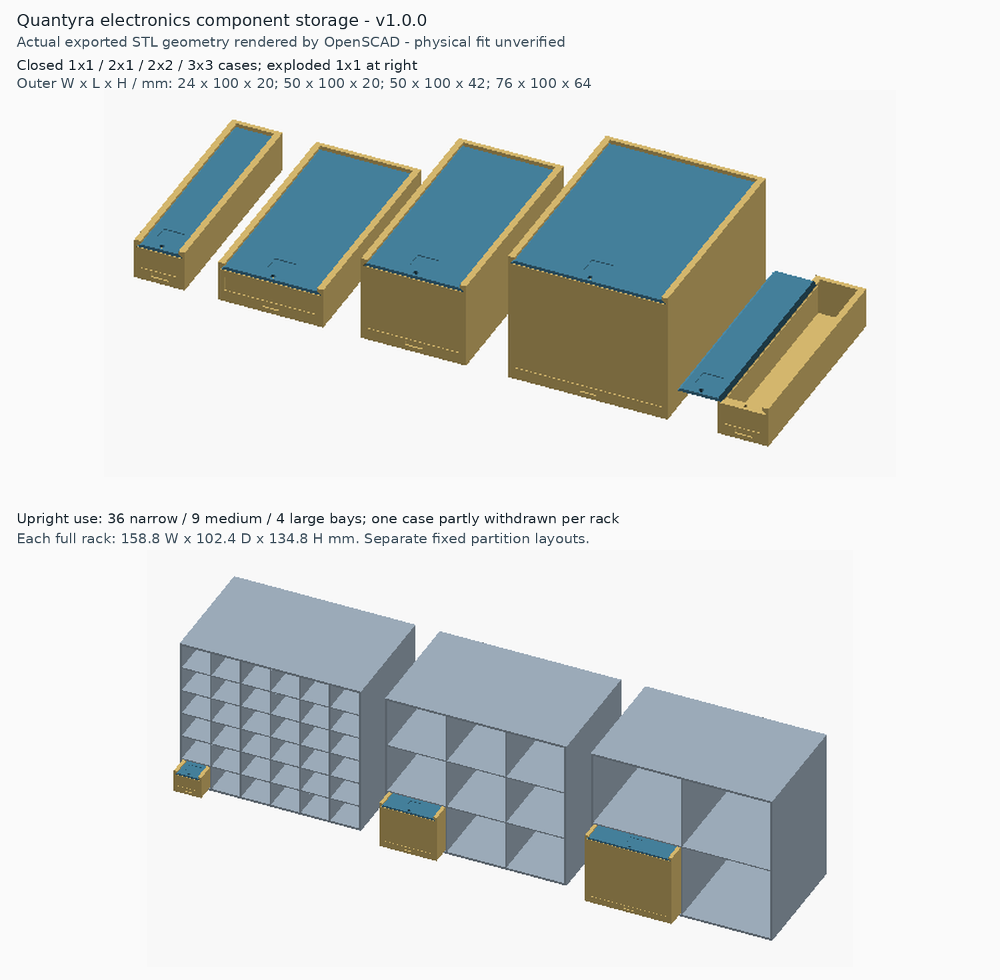
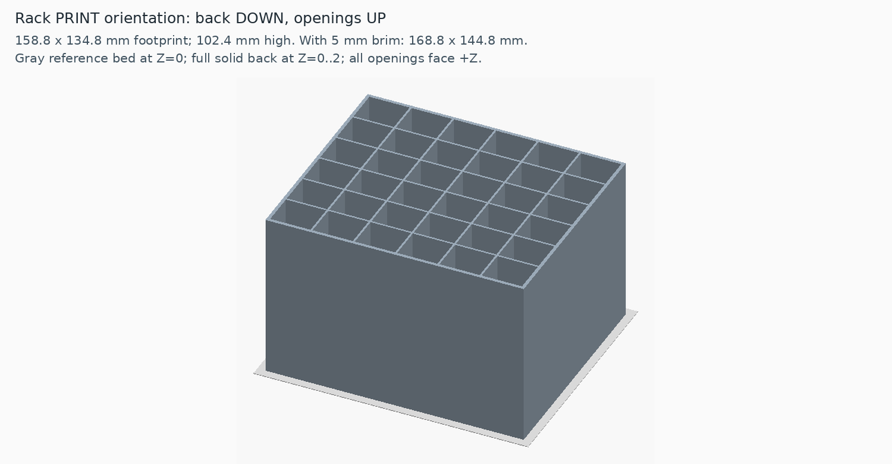

# Quantyra electronics component storage

v1.0.0: editable OpenSCAD and **12 printable STLs** for sliding cases and fixed-bay cabinets. Intended for an Ender-3 V3 SE (nominal 220 x 220 x 250 mm). This is bench organization, with no optical or quantum performance role.

**Physical fit, storage capacity, warping and load performance are untested.** Geometry validation is computational; no physical print or assembly result is claimed.

## Choose parts

All dimensions are nominal mm. The case lid slides along its length; the front label remains independent of the lid. Each width uses its matching lid; the two 50 mm cases share lid_2.

| Case / STL body | Outer W x L x H | Rectangular cavity W x L x H | Exact top opening W | Lid |
| --- | --- | --- | --- | --- |
| 1x1 / body_1x1 | 24 x 100 x 20 | 20 x 93.2 x 14.8 | 18 | lid_1 |
| 2x1 / body_2x1 | 50 x 100 x 20 | 46 x 93.2 x 14.8 | 44 | lid_2 |
| 2x2 / body_2x2 | 50 x 100 x 42 | 46 x 93.2 x 36.8 | 44 | lid_2 |
| 3x3 / body_3x3 | 76 x 100 x 64 | 72 x 93.2 x 58.8 | 70 | lid_3 |

Measure the whole protected component envelope, including full leads, tape and bag seams. Allow handling margin on all axes and passage through the narrower top opening. For taped or loose resistors, measure full lead/tape width separately from bundle thickness or rolled diameter. Roll carrier gently only if the parts and carrier permit; preserve leads when untaping. No quantity capacity is established.

| Fixed rack STL | Bay layout | Matching case | Case positions |
| --- | --- | --- | --- |
| rack_test_2x2 (small cabinet variant) | 2 columns x 2 rows | 1x1 | 4 |
| rack_narrow_36 | 6 x 6 | 1x1 | 36 |
| rack_short_18 | 3 x 6 | 2x1 | 18 |
| rack_medium_9 | 3 x 3 | 2x2 | 9 |
| rack_large_4 | 2 x 2 | 3x3 | 4 |

Full racks: **158.8 W x 102.4 D x 134.8 H in use**; **158.8 x 134.8 footprint x 102.4 high when printed**. Small four-bay rack: 54.8 W x 102.4 D x 46.8 H in use; 54.8 x 46.8 footprint x 102.4 high when printed. Partitions are fixed, not removable or universal mixed-size bays. Position counts describe geometry, not payload ratings.

## Print and assemble directly

1. Select a body and width-matched lid, plus a matching rack if wanted. Import [STLs](stl) in millimetres at 100%. Cases and racks can be printed directly; no preliminary calibration part is required.
2. Preserve supplied orientations: bodies floor-down, lids flat, racks **back-down with openings upward (+Z), starting at Z=0**. The full rack fits the nominal printer envelope, including an optional 5 mm brim (168.8 x 144.8 footprint). Verify the slicer's usable area and actual profile.
3. PLA or PETG, 0.4 mm nozzle, 0.20 mm layers, three walls and suitable infill are starting settings, not tested profiles. Inspect the layer preview; rack bays have no bridging roof in print orientation. Supports are not intended by the CAD. Account for adhesion and warping with your material/profile.
4. Remove burrs without damaging the rails. Insert the lid from the front until it reaches the rear stop. The default **0.30 mm normal clearance per mating face** is parametric in [storage.scad](cad/storage.scad), not a mandatory calibration procedure. Do not force a tight print. Preserve default geometry when using the supplied validation results.
5. The lid slides freely without a screw; the dovetail captures upward motion but is not a friction lock. Optional retention uses an **externally sourced M2x6 screw**, head no larger than 4 mm diameter x 1.4 mm high, through the lid clearance hole into the front-wall 1.6 mm pilot. Remove it before sliding. Do not overtighten; printed-thread retention and repeated use are untested.
6. Add a separate replaceable front label. [labels.svg](labels.svg) supplies example cut outlines, 18 / 44 / 70 mm wide x 7 mm high, and a 50 mm scale check. Slide cases straight into matching cabinet bays; keep withdrawal space clear and support the cabinet securely. Stability and load capacity are untested.

## Supported family selection

These are candidate package families after measurement, not universal package or capacity guarantees.

| Family | Candidate cases | Protection and selection |
| --- | --- | --- |
| Axial resistors / diodes, taped or loose | 1x1, 2x1 | Full uncut leads/tape width along length; check bundle and top opening |
| Radial ceramic / film capacitors, LEDs, TO-92 | 1x1, 2x1, 2x2 | Include lead projection, lens/body and carrier |
| Electrolytics, TO-220 / TO-247 / metal cans | 2x1, 2x2, 3x3 | Include full leads, tabs, sleeves and protective separation |
| DIP / SOIC, SMD cut tape | 1x1 for narrow tape; 2x1 or 2x2 for carriers | Keep pins/pockets protected; no sharp tape folding or cutting occupied tubes |
| QFN / BGA | 2x1, 2x2, 3x3 if protected carrier passes opening | Retain appropriate ESD and moisture protection |
| Inductors, relays, connectors, small modules | 2x1, 2x2, 3x3 | Include protrusions, packaging and weight; no payload rating |
| Full reels, long tubes, large trays / boards | Separate measured storage | No supplied full-reel adapter or guaranteed fit |

Ordinary printed plastic is not claimed to provide ESD shielding. Keep sensitive parts in suitable protective packaging. Retain manufacturer-required moisture barrier bags, desiccant/HIC and handling procedures. These sliding cases are not airtight or dry cabinets.

## Source, checks and licensing

- [Build and validation](docs/build-and-validation.md), [mesh validation results](reports/geometry-checks.json), [manifest](manifest.json), [SHA256SUMS](SHA256SUMS).
- Original self-contained [OpenSCAD](cad/storage.scad); [actual-mesh preview scene](cad/preview.scad). No firmware or G-code included.
- Hardware source, CAD, STLs, documentation, renders, build and validation helpers: [CERN-OHL-S-2.0](LICENSE). Commercial use is permitted under its conditions. [Separate paid qX / qXcellerate licensing guide](docs/licensing.md); inquiry grants no rights.
- [Attribution](ATTRIBUTION.md), [citation](CITATION.cff). Cite the [v1.0.0 archive DOI](https://doi.org/10.5281/zenodo.23634471); the [concept DOI](https://doi.org/10.5281/zenodo.23634470) covers all versions.

Source Location: https://github.com/Quantyra/electronics-component-storage

The [verified Zenodo record](https://zenodo.org/records/23634471) ([record API](https://zenodo.org/api/records/23634471)) archives the exact GitHub v1.0.0 release ZIP: 727,700 bytes, all 39 tagged files verified, SHA256 `a8a555cdc065f1eff7f2333b778acaf5407b32a3b8e9ee035be45090b4c9f89b`. Its immutable source is commit [`1e9ae7a9a759ee0fc2413a03018a9c719e88ab74`](https://github.com/Quantyra/electronics-component-storage/tree/1e9ae7a9a759ee0fc2413a03018a9c719e88ab74), tree `a515a3a39477d8491a8fb0d4db034715784064cc`. Subsequent main-branch metadata updates, including these DOI notices, are outside that tagged archive; the v1.0.0 tag and ZIP remain unchanged. This was a manual API deposit; automatic GitHub-Zenodo integration is not enabled or promised.
